# P3 Clusters

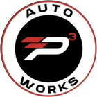

Redraws the whole instrument cluster in a theme of your choice. Open **P3 Clusters** from the apps menu on the center screen: its own page has the themes with pictures, the readouts, the badge, the Waze map, warnings and settings.

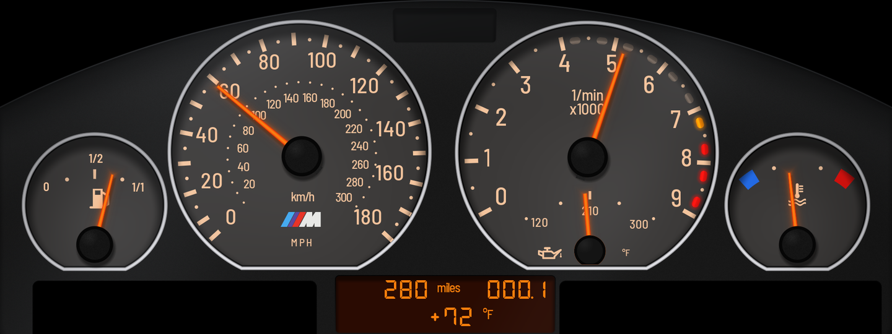

## Themes

Seven themes: **E46 M3**, **E36**, **Sweep**, **Dyno**, **Ribbon**, **Apex** and **Vetro**. Every theme fills the cluster but leaves BMW's gear and drive programme display at the bottom right uncovered (x 1214 to 1525 of the bottom row on a G80 M3): when a theme covers any of it, BMW draws black boxes over the theme.

### E46 M3

The E46 M3's cluster in orange, drawn to match a sketch of the real one.

- **Speedometer:** 0 to 180 mph with km/h on an inner scale, and the M badge.
- **Rev counter:** 0 to 9, with the oil temperature gauge (120 to 300°F) in its lower cut: an oil can bottom left, °F bottom right.
- **Fuel and coolant:** small dials either side. The coolant needle starts to rise at 100°F; its first dot is 160°F, the middle 215°F, the second dot 235°F and the red 240°F.
- **Lights round the rev counter:** one every 500 rpm from 4000 to 9000; the ones past 7500 are red, the rest orange. The orange ones from 4000 to 7000 are warm-up lights: all on below 100°F oil, going out one by one from the lowest as the oil climbs to 160°F. From 6000 rpm they light from the top down as shift lights, and above 6900 rpm every light blinks.
- **LCD:** the range, a trip counter and the outside temperature.
- **At night** (after sunset with **Night colours** on Auto, or always with **Always**) the dials light up like a real E46 M3's at night: warm yellow-amber print on dark backlit faces, orange needles, amber-glowing rings and an orange-red LCD.

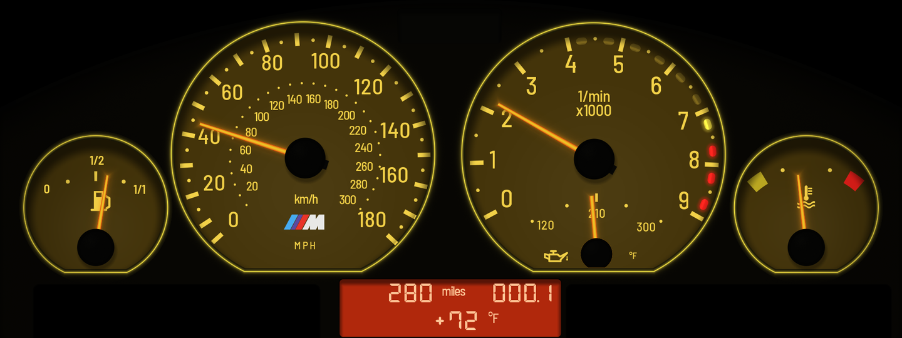

### E36

A pure E36 cluster of the 90s: white print on black dials in a dark grey face, with an LCD for the range, trip, clock and outside temperature.

- **Redline 7200:** the E36 always redlines at 7200 rpm on the M3 face (0 to 8, with its oil temperature gauge and red needles), whatever the **Redline** setting says; its shift lights and shift point use 7200 too. The other themes still follow **Redline**. In mph or km/h by **Units**.
- **mph speedometer:** 0, 10, 20, then every 5 mph, as on the real US cluster.
- **At night** the print and needles turn the E36's orange-red, as in night photos of the real car.

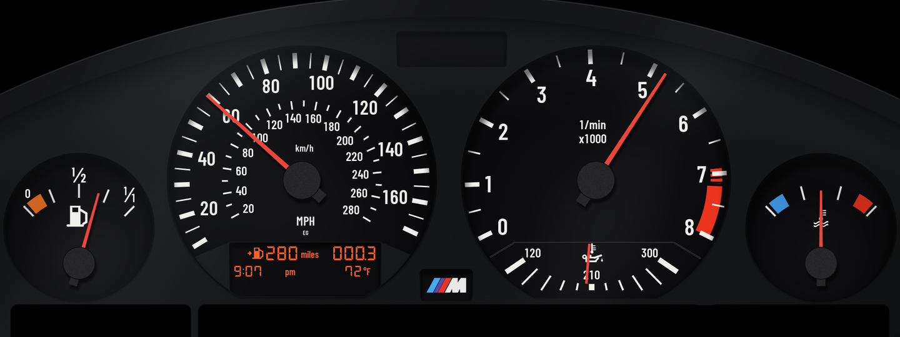

### Sweep

A digital dash with a rev sweep across the top, set up on a 2022 M3 (jsalicru's fork).

- **Top:** a segmented rev sweep under BMW's turn signal arrows, machined silver or amber (**Color (Sweep)**), 0 to 8, red from your Redline setting (7200 rpm by default). Below 120°F oil the red zone starts at 4000 rpm and rises to your redline by 160°F. The two lines just below the red zone are always yellow; over the last 1200 rpm before it the lit segments turn yellow from the red zone back toward 0, all of them by the redline. 7400 to 8000 rpm is one solid block at 3/8 of its width. From your shift point the lit segments flash red about 5 times a second (**Flash revs at shift point (Sweep)**). **Rev scale (Sweep)** picks Even, or a Race scale with 5000 or 5500 rpm in the middle. This is only what's shown: it doesn't limit the engine.
- **Middle:** with **Sweep: window for BMW's map view** on (Map tab, the default), a borderless six-sided window over BMW's map view, with a soft tab on the left that opens as far as BMW's speed needs; the theme shows no speed of its own there. Off, the gear above a large digital speed, and the gauges grow to fill the room.
- **Left:** boost (0 to 30 psi) and fuel with the range, with brackets like the temperatures' in the bar colour; fuel and its brackets turn yellow under 50 miles.
- **Right:** oil and water bars, with the outside temperature in the bottom right corner. A thin blue bracket runs under the first 4 segments and up the bar's start, and a red one over the last 4 and down its end. Oil runs 125 to 275°F: cold (blue) up to 150, orange above 235, red above 250. Water runs 115 to 265°F: cold up to 140, red above 240.
- **BMW's gear display:** **Leave BMW's gear letter open (Sweep)** (on by default) keeps BMW's whole gear and drive programme area at the bottom right see-through, so BMW draws no black boxes.
- Waze shows in the window in its usual place (Waze on Cluster); Sweep doesn't use **Show Waze map inside the theme** yet.

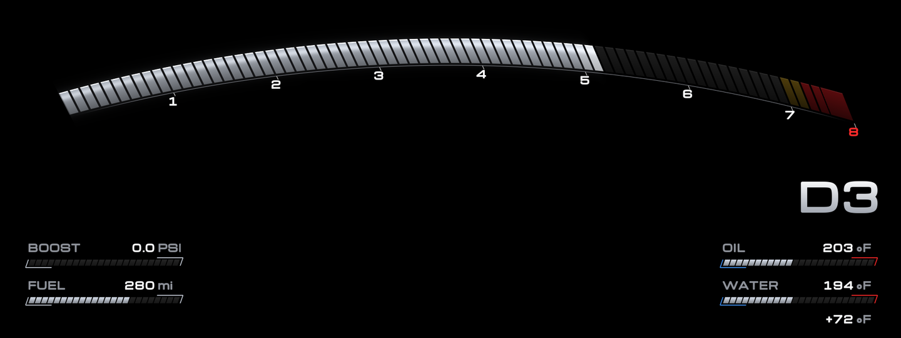

### Dyno

A safety dash for hard pulls, in BMW M colours: twelve tiles in a grid (rpm, speed, boost, oil, coolant, intake air, cornering g, braking or accelerating g, the gear, fuel, your shift point and your last shift) and tall Power and Torque tiles on the right, each with a bar that runs light blue, dark blue, then red. A tile's number flashes red while its oil, coolant or boost reading is over your warning limit. A rev bar runs across the top. Every tile but the gear can show another sensor (Readouts tab).

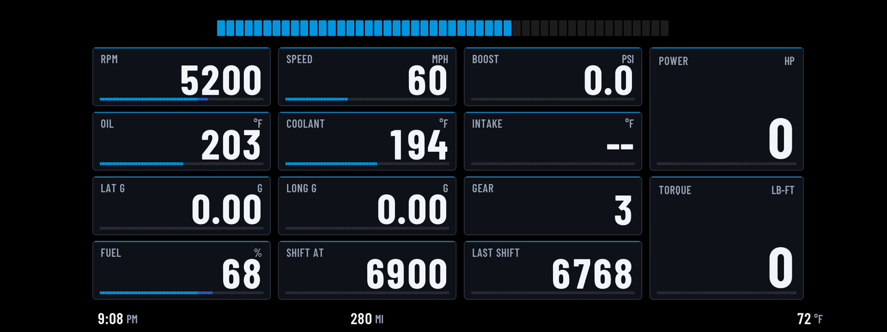

### Ribbon

Calm and premium. One ribbon of light runs along under the top edge of the cluster and fills with the revs, cool white warming to amber, then red near the redline, with a dot and a number at every thousand (the last two in red). The speed sits in the middle in big thin numbers with the gear in a small frame above it. Oil, coolant and boost are on the left, and fuel and your average speed this drive on the right.

**Holiday editions:** Christmas (the ribbon becomes a string of coloured bulbs that light up with the revs, with falling snow), Thanksgiving (falling maple leaves), New Year (bubbles and gold confetti) and the Fourth of July (fireworks), each with its own colours and a greeting under the speed. The decorations stay clear of the numbers. Set by **Holiday editions** in Settings.

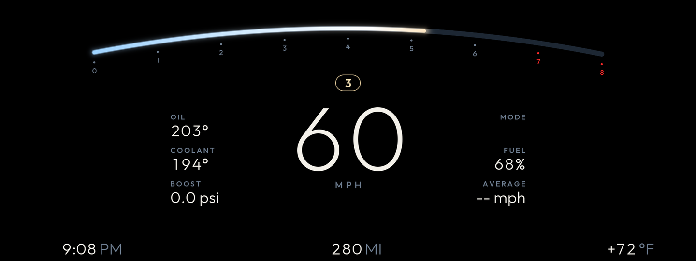

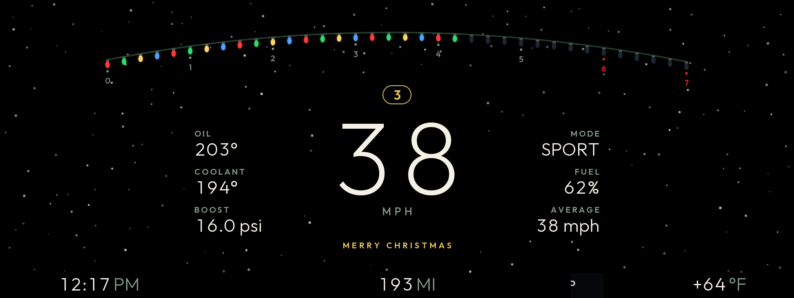

### Apex

A needle dash in a mid-engine supercar style, imported from jsbaughman/apps (Cluster Themes 0.25.8).

- **Middle:** a round rev counter, 0 to 8, with a red needle. **Tach finish (Apex):** Lit segments in layered rings (the default: the band in glowing blocks sunk in a groove between chrome rings, a notched inner ring, fine marks every 100 rpm, a needle shadow and a glass sheen), Flat, Machined, Lit segments or Layered rings.
- **Red zone (Apex):** Warm-up (the default), as Sweep's: below 120°F oil the red zone starts at 4000 rpm and rises to your Redline setting by 160°F, with a yellow zone in the 200 rpm under it. Over the last 1200 rpm before the red zone the lit band turns yellow from the red zone back toward 0, and from your shift point the lit band flashes red about 5 times a second (**Shift light (Apex)** off stops the flash). Fixed keeps amber from 6500 and red from 7000.
- **Type (Apex):** Wide, Sweep's Michroma (the default), or Italic, Apex's own. The gear sits in the middle (outlined or solid, **Gear (Apex)**), the speed in the open lower right quarter (**Speed in the tach (Apex)**). With **Shift light (Apex)** on, the tach flashes red at the shift point.
- **Left:** two readouts, boost and oil temperature by default (**Left gauge, top / bottom (Apex)**: boost, oil temp, intake temp, oil pressure or water temp), as hatched gauges with a scale or as thin bars (**Left side (Apex)**, **Gauge fill (Apex)**). Oil pressure is read from the engine unit and is not yet checked on an S58.
- **Right:** a G-meter, the tire pressures and temperatures round a car seen from above, or horsepower and torque (**Right side (Apex)**).
- **Bottom:** coolant and fuel, then the theme's own clock, range and outside temperature in the strip. BMW's gear and drive programme area (x 1214 to 1525) is left uncovered, as in every theme here.
- **Background:** red glow at the sides or carbon lit from the tach (**Background (Apex)**); **Backgrounds (Apex)** off draws plain black. **Glow round the gear (Apex)**: off, red or white.
- **With the driver camera:** **Leave room for the driver camera** draws a smaller tach lower down.
- With **Show Waze map inside the theme** on, the Waze map shows as a round window inside the tach.
- Its settings show on the Settings tab only while Apex is on the cluster. Not yet tested on this car.

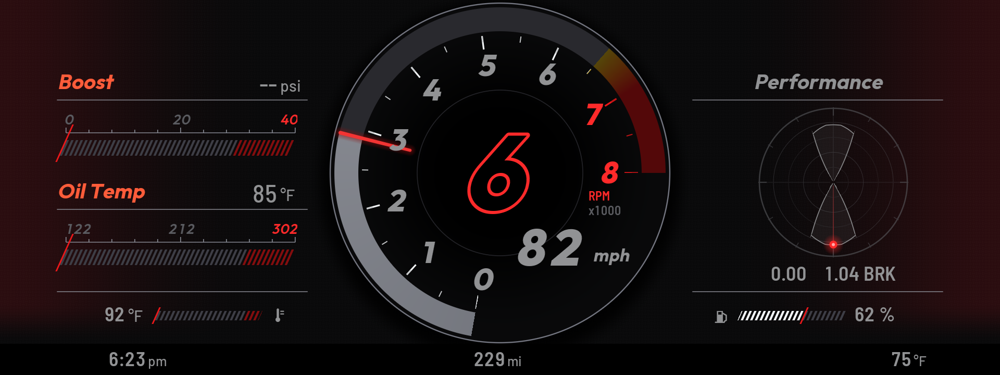

### Vetro

An Italian GT style dash: a round dial under glass on a perforated metal floor, with blue glass panels round it. Imported from jsbaughman/apps (Cluster Themes 0.26.11), with its right panel changed for this car.

- **Middle:** the rev counter, 0 at six o'clock clockwise to 8000 rpm, a ladder of ticks with a dot at each thousand, red from 7200; silver Michroma numbers; a red needle with a glow and a centre cap. The speed and the gear (AUTO / MANUAL under it) sit in see-through navy boxes. It flashes red at the shift point. **Rev display (Vetro):** Needle + lit ticks (the default, Sweep style: the ticks light silver up to the revs with the needle kept; the red zone starts at 4000 rpm on a cold engine and rises to your Redline setting as the oil warms, a yellow zone under it, the lit ticks turning yellow as you near it and flashing red from the shift point), Needle alone, or Lit ladder (no needle, a peak mark after each pull). **Dial colour (Vetro):** black, red or yellow. **Brighter look (Vetro)**.
- **Left:** a blue panel with four bars: boost (intake with "Show boost" off), oil temperature, water temperature and oil pressure, the temperatures in Sweep's colours (blue cold, orange warm, red hot); the fuel and range under it, silver, amber under 50 miles. **Peak boost (Vetro)** marks the highest boost of each pull.
- **Rev scale (Sweep, Vetro):** Even, or Race with 5000 or 5500 rpm at the top of the dial (more of the dial for the top of the rev range). The warm-up red zone and shift flash work in every Rev display; **Shift light** turns the flash off.
- **Map:** with **Show Waze map inside the theme** on, the Waze map takes the left panel while it shows (the panel reaching further left for a bigger map), fading into the dial, and the four bars and the fuel move to the right panel, the boost bar with its PEAK reading.
- **Right, without the map (Right panel (Vetro)):** **Now playing** (the default: the song, the artist, its progress and times, from the head unit's own media state; "Nothing playing" otherwise) or **Tire pressures** (the car from above with each tire's pressure and temperature).
- No smaller tach for the driver camera. Not yet tested on this car.

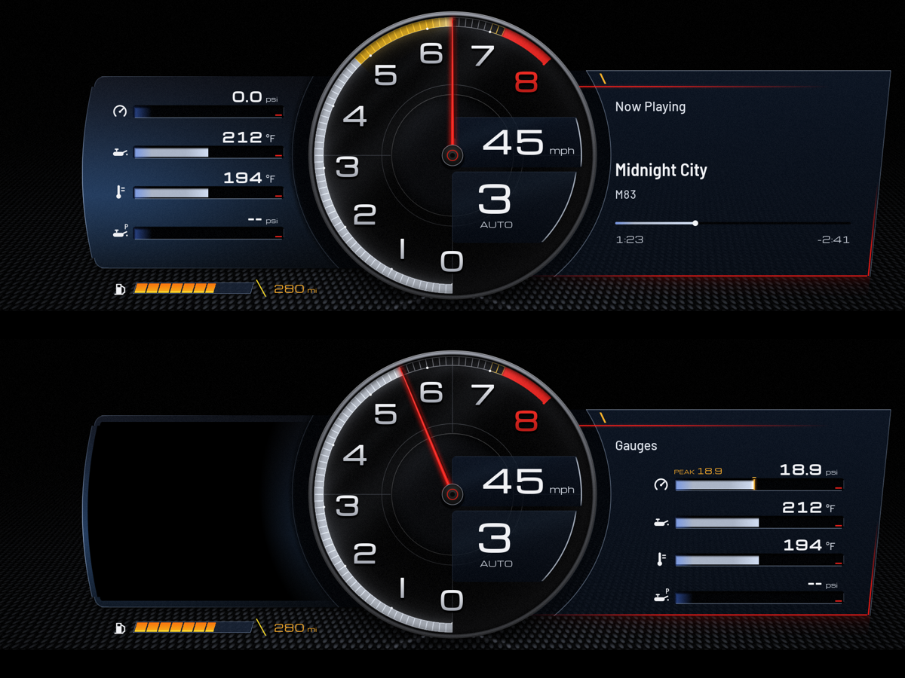

E46 M3, E36, Dyno and Ribbon have no map window; with "Show Waze map inside the theme" on, Waze stays in its usual place while they show.

## Off and drive modes

- **Off (BMW's own cluster):** pick it as the theme and the app draws nothing, so BMW's cluster comes back.
- **Change with SPORT / COMFORT / ECO PRO** (on by default): the cluster follows the drive mode buttons, with a theme for each mode. Out of the box, every mode shows Sweep. Until the car reports a mode, the plain theme setting is used.
- **M cars:** the Efficient, Sport and Sport+ modes of M cars are not recognised yet, so the theme doesn't change with them. The last line of the Settings tab shows the value your car sends; please post it in an issue so it can be added.
- **With HUD Widgets:** on cluster-render 0.5.1 and newer, a cluster theme and a HUD layout show at the same time. On older cluster-render they share one screen slot and take turns: pick a theme while the HUD is on and the page asks whether to turn HUD Widgets off, and it asks the same the other way round.

## Settings

- **Theme**, and one per drive mode.
- **Readouts:** pick which car sensor each Dyno tile shows (speed, rpm, boost, temperatures, tyres, fuel, g, power and more). Plug-in hybrids can also show **Hybrid battery**, the high-voltage battery's charge in % (not yet checked on a hybrid).
- **Show Waze map inside the theme:** for themes with a map window of their own (Apex, a round window in the tach; Sweep's window shows BMW's map and Waze in their usual place). While it is on, Waze's map on the HUD is off. Needs robertnisipeanu's Waze on Cluster.
- **Badge:** the model name, like "BMW X3 M40i", as text in the theme's font . Off by default.
- **Warnings:** oil, coolant and boost limits. A readout over its limit flashes red (oil 130°C and coolant 115°C by default, boost off).
- **Test the shift lights:** runs the rpm up to the shift point for about 4 seconds while the car stands.
- **Play demo:** the button at the top of the page plays a 60-second show on the cluster while the car stands (a pull through the gears with graded shifts, the limiter, braking, corners, boost, the oil warning once), with a DEMO tag. It stops at the end, on Stop, or as soon as the car moves, and nothing from it is kept.
- **Shift lights:** Count in (the default) fills the lights over about the last second before the shift point and flashes early by your reaction time; Fixed rpm band works as before. Ported from Redline (MIT).
- **Temperatures only when they matter** (off by default): oil and coolant turn blue while cold, yellow while warming, red over their limit; the outside temperature turns blue at 3°C (37°F) and under.
- **Night colours:** after sunset (Auto, the default) or all the time (Always), the theme's whites and greys dim to 60%; E46 M3 and E36 switch to their own night lighting instead. Off keeps the day colours.
- **Units:** mph, °F, psi or km/h, °C, bar. **Temperature** and **Pressure** can differ from the speed's units (Apex; both start on Match speed).
- **Clock:** 12-hour or 24-hour.
- **Time zone (clock):** the head unit's clock runs on UTC, so pick your zone once. Named zones (US Eastern, Central, Mountain, Pacific, Alaska, Hawaii, Arizona, Canada Atlantic, Mexico, UK / Ireland / Portugal, Central Europe, Eastern Europe) change for daylight saving by themselves; for anywhere else, pick your offset from UTC. Night colours uses the same zone to work out sunset.
- **Fuel tank size:** the fuel gauge asks the engine unit for the level in %. Where the engine unit doesn't answer, it works it out from the litres the car reports and this size (65 L on an X3, 59 L on a 3 Series).
- **Redline:** where the red marks start on the rev scales (they always cover at least the last 500 rpm, and the yellow marks sit in the 700 rpm before them).
- **Shift point before redline:** how far below the redline the shift lights peak (300 rpm by default).
- **Cold-engine rev guard:** until the oil reaches 80°C, the shift point starts at 4500 rpm and climbs as the oil warms up.
- **Show boost.**
- **Leave room for the driver camera** (off by default): for newer cars with a driver attention camera in the top middle of the cluster, where other cars show the model badge. The rev bar (Dyno) becomes two mirrored wings either side of the camera that fill from the outer ends in towards it and meet at the shift point, and Ribbon's ribbon dips under the camera instead. The camera's spot is taken from where the badge sits on a car without one. Not yet tested on a car with a camera; please report how it lines up on yours.
- **Holiday editions:** a string of glowing holiday lights along the top of every theme, and Ribbon's own holiday edition. Auto (the default) puts them on by the date: Thanksgiving in its week (Monday to Sunday), Christmas from December 1 to 26, New Year from December 27 to January 2, and the Fourth of July from July 1 to 5, then takes them off again. Or pick one holiday to keep it on, or Off. The date follows the Time zone (clock) setting.
- **G-meter** (its own tab): the range (0.8, 1.0, 1.2, 1.5 or 2.0 g at the edge; 1.2 by default), the trail (off, 1, 2 or 4 seconds), **Swap left / right** (if the dot goes the wrong way in a turn) and **Brake on top**, the best left, right, accelerating, braking and overall g of the drive with a Reset button, and a live copy of the meter. The g comes from the car's own acceleration sensor: parked on level ground it reads 0.00, and a hill adds a little.
- **Demo data:** fake driving data for trying it out parked. It switches back to the car's own data as soon as the car moves faster than 5 km/h.
- **Calibration grid:** a theme that draws lines every 50 px with labels, for checking on a photo where things land on the real screen. It also carries a few test marks used to measure cluster-render's limits on the car.
- **Map calibration:** a theme that leaves BMW's whole map window open with a grid through it, for photographing exactly what shows through the map cut-out with a navigation map up.

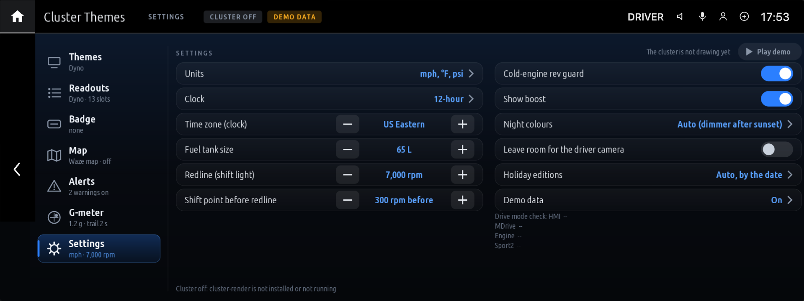

**Shift grades:** every upshift is graded on its peak rpm. EARLY means more than 250 rpm under the shift point, LATE more than 200 over it, COLD REV the same while the cold guard is on, LIMITER within 25 rpm of the redline, and anything in between is SPOT ON. Only shifts aimed at the shift point are graded: one more than 1500 rpm under it (an everyday shift) or one the gearbox made itself in D or S is left out, and the last grade stays on screen. When Redline 2.0.28 or newer is running, the shift point and the grade come from Redline, which learns a shift point for each gear.

## Requirements

[cluster-render](https://github.com/robertnisipeanu/idrive-apps), installed from the `robertnisipeanu/idrive-apps` Store source. Version 0.5.1 or newer lets the theme show together with HUD Widgets.

## On the car

Tested on a 2022 M3 (G80) and a 2020 X3 M40i. Checked on the car: E46 M3, E36 and Sweep draw complete on the M3, E46 M3 with no black boxes, and a theme and a HUD layout show together. Still to be checked:

- the black-box fix (0.19.0) in E36, Sweep, Dyno and Ribbon, and Dyno and Ribbon on the M3;
- whether BMW's warning lights still show over the dash (start the car with a seat belt off and look);
- the clock with a named time zone, and the fuel % from the engine unit;
- the Hybrid battery readout on a plug-in hybrid;
- Play demo, the count-in shift lights and the switch-off guard (0.16.0).

If something looks wrong on your car, the last line of the Settings tab says what the app is doing and why anything is not drawn. Please open an issue with it.

See [Use at your own risk](../../README.md#use-at-your-own-risk) before installing.

Version history is in the repo's [CHANGELOG.md](../../CHANGELOG.md).
